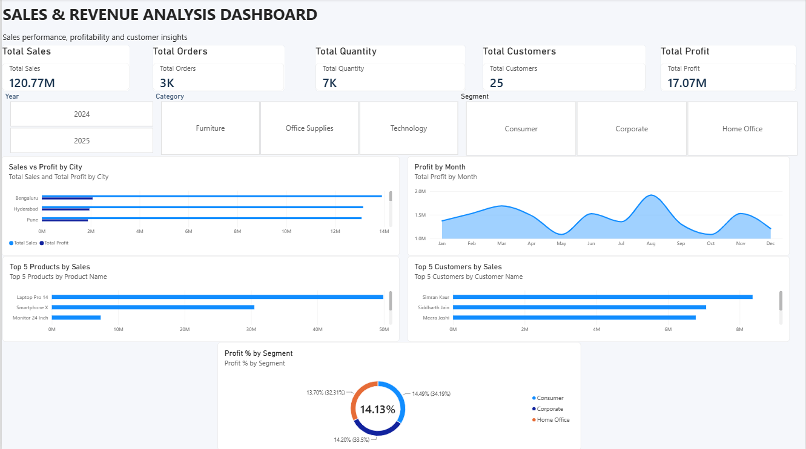

# Sales & Revenue Analysis Dashboard

An interactive Power BI dashboard for exploring sales performance, orders, quantity, customers, profitability, and customer and product contributions.

## Dashboard preview

## Highlights

- KPI cards for total sales, orders, quantity, customers, and profit
- Filters for year, category, and customer segment
- Sales and profit comparison by city
- Monthly profit trend
- Top products and customers by sales
- Profit percentage by segment

The preview shows reported totals of **120.77M** in sales, **3K** orders, **7K** quantity, **25** customers, and **17.07M** profit. These figures reflect the screenshot and may change when the report data is refreshed.

## Files

- `Sales-Revenue-Analysis.pbix` — Power BI report (add this file to the repository)
- `dashboard-preview.png` — dashboard screenshot
- `[dataset filename].xlsx` — optional source dataset (add if you intend to share it)

## Open the report

1. Download or clone this repository.
2. Open `Sales-Revenue-Analysis.pbix` in Microsoft Power BI Desktop.
3. If prompted, update the data source path to point to the dataset.
4. Refresh the data to view the latest results.

## Data

Describe the dataset and its source here. If the dataset is not included, users will need their own copy and may need to update the report's data source settings.

## Author

Add your name here.
