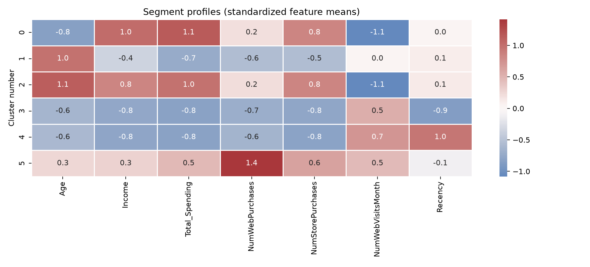

# Week 2 — Customer Segmentation

Customer segmentation analysis using K-means clustering on customer demographics and purchase behavior. This project includes a reproducible Python analysis, an optional Streamlit segment predictor, a notebook, and generated charts.

## Preview

More charts: [PCA customer segments](customer_segments_pca.png) · [Elbow and silhouette evaluation](elbow_silhouette.png)

## Results

- Source records: 2,240
- Records removed for missing income: 24
- Records removed for invalid age: 3
- Records used for clustering: 2,213
- K-means solution: 6 clusters
- The six segments range from higher-spending, higher-income customers to lower-spending groups with different online activity and recency patterns.

The six-cluster solution follows the tutorial's selected value of K. The silhouette evaluation is included so the choice can be reviewed; in this run, K=2 had the highest silhouette score (0.321), while K=6 scored 0.185. Cluster numbers are labels produced by the model, not ranked customer values.

## Files

- `week2-customer-segmentation-project.zip` — complete project with code, notebook, requirements, and report outputs
- `segment_profiles.csv` — aggregate customer characteristics by cluster
- `cluster_count_evaluation.csv` — inertia and silhouette scores for K=2 through K=10
- `segment_profiles.png`, `customer_segments_pca.png`, `elbow_silhouette.png` — generated charts

The raw customer CSV and trained model bundle are not included. The CSV contains customer-level income and purchase behavior. To run the analysis, download the Customer Personality Analysis dataset from [Kaggle](https://www.kaggle.com/datasets/imakash3011/customer-personality-analysis) and follow the instructions in the ZIP's README.

## Tools

Python, pandas, scikit-learn, matplotlib, seaborn, joblib, and Streamlit.

## Tutorial

[Customer Segmentation Using Machine Learning (K-Means Clustering)](https://youtu.be/-LGwdrajMZ0)
